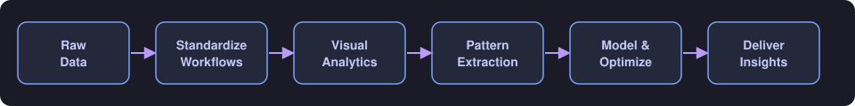
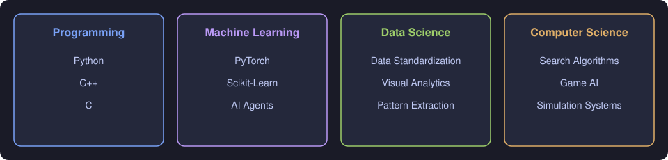

<!-- ===================== HEADER BANNER ===================== -->

  

<!-- ===================== INTRO ===================== -->

  <h1>Hi there, I’m a Data Science student at FAST University 🎓</h1>
  
I bridge applied mathematics to build practical AI models and data-driven systems.

  

 

<!-- ===================== QUICK FACTS TABLE ===================== -->

| 🎓 Education | 🧠 Focus | 💻 Languages | 🤝 Open to |
|:---:|:---:|:---:|:---:|
| **FAST University (FAST NUCES)** BS Data Science | Machine Learning Data Visualization Algorithms | Python · C++ · C | Collaboration Open-source Research |

 

<!-- ===================== GITHUB STATS ===================== -->

  <h3>📊 GitHub Analytics</h3>
  
  
   
  

 

<!-- ===================== CONTRIBUTION GRAPH ===================== -->

  <h3>📈 Contribution Activity</h3>
  

 

<!-- ===================== TECH STACK ===================== -->

  <h3>🛠️ Core Tech & Frameworks</h3>

<table align="center">
  <tr>
    <td align="center"><b>Languages</b></td>
    <td>
      
      
      
    </td>
  </tr>
  <tr>
    <td align="center"><b>ML / AI</b></td>
    <td>
      
      
      
    </td>
  </tr>
  <tr>
    <td align="center"><b>Systems</b></td>
    <td>
      
    </td>
  </tr>
  <tr>
    <td align="center"><b>Tools</b></td>
    <td>
      
      
      
    </td>
  </tr>
</table>

 

<!-- ===================== WORKFLOW DIAGRAM ===================== -->

  <h3>🔄 How I Approach Data Problems</h3>

  

 

<!-- ===================== SKILL MAP ===================== -->

  <h3>🧭 Skill Map</h3>

  

 

### 📌 Research & Focus Area

- 🔭 **I’m currently working on:** Research in Data Visualization & an ongoing Algorithm optimization project
- 🌱 **I’m currently learning:** Data standardization workflows, pattern extraction through visual analytics, and algorithm selection for complex problem-solving
- 👯 **I’m looking to collaborate on:** Applied machine learning tools, open-source data science projects, and software engineering
- 🤔 **I’m looking for help with:** Advanced research directions in Data Science and AI Agent architecture

 

### 📫 How to reach me

  
  

<!-- ===================== SNAKE ANIMATION ===================== -->

  <picture>
    <source media="(prefers-color-scheme: dark)" srcset="https://raw.githubusercontent.com/HussainZaman920/HussainZaman920/output/github-contribution-grid-snake-dark.svg" />
    <source media="(prefers-color-scheme: light)" srcset="https://raw.githubusercontent.com/HussainZaman920/HussainZaman920/output/github-contribution-grid-snake.svg" />
    
  </picture>

<!-- ===================== FOOTER ===================== -->

  

